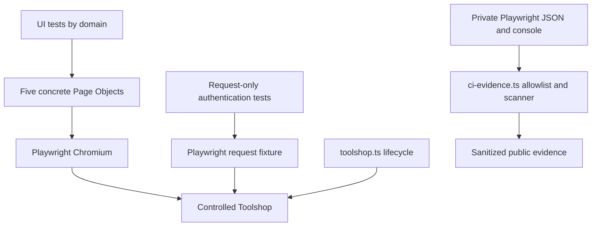

# Solution Architecture and Portfolio Defense

This is the primary technical deep dive for Portfolio v1.0. [README](../README.md) is the entry point; [requirements](requirements.md) and the [catalogue](test-catalogue.md) are current traceability; historical release packages preserve investigation and approval evidence. [R16](release-16-summary.md) records stabilization execution, including controlled failures and repeatability.

## 1. Solution overview

This repository automates selected customer journeys in Toolshop, a demonstration e-commerce application. The objective is a credible, understandable QA automation portfolio, not exhaustive product certification or a general-purpose automation framework. The functional baseline is **26 scenarios: 23 UI + 3 API**, using Playwright Test, strict TypeScript, Node.js/npm, Docker/Compose and GitHub Actions.

The project is **AI-assisted**. AI accelerated source analysis, implementation, evidence inspection and documentation. Álvaro owned scope, test/risk decisions, review, validation/acceptance and progressive technical understanding. Implementation authorship was assisted; agent-executed validation demonstrates repository behavior. Personal technical fluency should be demonstrated by replaying commands, explaining evidence and making a small reviewed change. This portfolio represents a developing automation engineer's project ownership and learning.

## 2. Architecture



| Area | Responsibility |
| --- | --- |
| tests/ui/authentication | Customer login/logout and browser route access |
| tests/ui/catalog | Search/details, filtering/intersection and browsing |
| tests/ui/cart | Add/merge, quantity persistence, removal/empty state |
| tests/ui/checkout | Identity/billing and authenticated/guest COD orders |
| tests/api/authentication | Direct authorization, account locking, explicit JWT invalidation |
| LoginPage | Sign-in/out locators and actions |
| CatalogPage / ProductDetailsPage | Discovery/filter/navigation actions and product information/control locators |
| CartPage / CheckoutPage | Cart mutations and concrete checkout controls/actions |
| scripts/toolshop.ts | Pinned provisioning, lifecycle lock, readiness, reset/seed and controlled execution |
| scripts/ci-evidence.ts | Private capture, compact results, artifact scanning/staging |

Tests own business setup, expected values, assertions and scenario-specific network synchronization. Page Objects own UI locators/actions, with no assertions or shared business state. Each test constructs its own objects and browser/request context. Browser isolation protects client state; it does not reset backend counters, invoices or queues. Reset/seed occurs **per controlled invocation**, not per test.

There is no BasePage, service container, generic API client, filter strategy, flow engine or fixture hierarchy. Explicit repeated setup is acceptable while the risk and assertions remain visible in one file. A future abstraction must solve demonstrated duplication/resource ownership, rather than simply shorten tests.

Native tags assign exactly one layer, one primary domain and @regression. Five critical paths also have @smoke. Domains are auth, catalog, cart and checkout; purchase belongs to checkout. API auth belongs to auth. Subset aliases forward native --grep to the same controlled runner: full 26, UI 23, API 3, smoke 5, auth 7, catalog 8, cart 6, checkout 5. They are selections, not separate pipelines.

## 3. Test strategy and oracles

Coverage follows distinct risks: incorrect identity/access, wrong discovery/filter results, lost or duplicated cart quantity, stale empty-cart controls, invalid billing progression and order acceptance/persistence. It deliberately stops at 26 representative scenarios before stabilization. Adding a product-name variant would not necessarily add a different risk.

UI is used when browser behavior is the subject: selected products, form progression, cart rendering and checkout. API is used for exact backend security transitions: anonymous /users/me rejection, three invalid passwords followed by locked login, and explicit same-token revocation. An API read used to corroborate a UI flow does not turn that case into a standalone API scenario.

Readable literal prices/product names/statuses are intentional oracles backed by the pinned seeder and runtime. Examples: Combination Pliers at 14.15; two accumulated units at 28.30; exact seeded brand/intersection sets. Generated cart/invoice IDs and references come from the test's own responses. No test assumes fixed resource IDs or derives a filter's expected set solely from the response under test.

Important boundaries:

- **Authenticated purchase:** one COD order, generated-reference UI confirmation, owned-cart deletion/client clearing, then independent authenticated exact-invoice readback for line/quantity/total/payment/initial AWAITING_FULFILLMENT.
- **Guest purchase:** one anonymous guest creation, server-computed amount/reference, null customer ownership, matching UI and purchased-cart DELETE plus independent GET 404. No anonymous invoice-read endpoint exists. Read-only operational audits corroborate guest invoice/line/payment/status outside the shipped assertion path; this is not advertised as automated anonymous invoice readback.
- **UI sign-out:** removes browser auth and blocks subsequent /account access; observed old JWT remains usable. Explicit backend /users/logout separately invalidates its JWT. The UI test does not invent a token-revocation requirement.
- **Locking:** invalid attempts 1–3 return 401; subsequent wrong/correct login returns 423. A third dedicated seeded customer is distinct from positive and single-negative UI accounts. Reset owns persistent lock recovery.
- **Catalog pagination:** exact controlled seed partitions are not a universal production sorting guarantee. Price/multi-brand/hierarchy matrices remain outside v1.0.

Requirement approval is a human decision. Passing automation and pinned stories/source strengthen evidence but do not automatically approve a candidate. Five older requirements remain Requires confirmation; no R16 result promotes them. The catalogue maps all 26 test IDs and exact titles to current requirements.

## 4. Controlled Toolshop environment

The public/shared deployment was insufficient for reference CI: historical Cloudflare verification, account deletion/drift, shared lock counters and uncontrolled catalogue/reset behavior prevented reproducibility. The project does not attempt to bypass that public-host protection. Public Toolshop remains an optional exploratory comparison, not controlled regression evidence.

The [lock](../environment/toolshop.lock.json) pins official Toolshop **tag 2.5**, source **9e7736c3841ec2bbb9a6822c9e6602353b7b9a65**, and four images by SHA256 digest. The helper verifies the upstream commit/origin, normalizes official production Compose, removes source builds, keeps four named services and writes ignored .sut/compose.json. Source is external and unmodified. A tag identifies the version; exact source and image digests prevent moving tags from silently changing the tested system.

| Service | Role | Platform / access |
| --- | --- | --- |
| angular-ui | Angular frontend | linux/amd64; local UI port 4200 |
| web | Nginx gateway to API | Pinned image is linux/arm64; local gateway port 8091 |
| laravel-api | Laravel application, seed and queue storage | linux/amd64; accessed through web |
| mariadb | Disposable database state | linux/amd64; not published by the helper |

On AMD64 CI the gateway needs ARM64 emulation. The workflow installs a pinned binfmt/QEMU image, then verifies the selected web image architecture and aarch64 execution. QEMU bridges architecture, not application version or data determinism. Other services run natively on AMD64. Hosts need equivalent support; simply removing the override would invalidate the pinned gateway contract.

Lifecycle:

1. **provision:** verify/fetch pinned source; derive ignored positive/negative/locking credentials from pinned public seed defaults without printing them. Existing files receive missing locking keys without replacing other configuration; external environment values take precedence.
2. **up:** generate locked four-service Compose, pull digests, start services and check readiness.
3. **ready:** require all four services running; poll API /status for a version-bearing success and frontend HTTP for app-root. Each HTTP attempt is bounded to 3s; overall API/frontend checks are bounded to 180s. This proves service/bootstrap readiness, not completion of every Angular route/render.
4. **reset:** database ping bounded to 120s; config:clear, migrate:fresh --seed --force, cache:clear; repeat readiness and require nonempty seeded product data. This resets accounts/locks, catalogue, carts, invoices/payments and queued jobs in this disposable database. IDs/timestamps may change after every reset.
5. **test:** validate required account configuration, ready/reset, then launch Playwright with injected controlled endpoints/accounts and fixed supported execution options.
6. **down:** compose down --volumes --remove-orphans. CI separately checks absence of project containers, networks and volumes. Source/images/ignored credential file remain for reuse.

Lifecycle commands serialize using .sut/operation.lock. It cannot coordinate arbitrary direct browser/manual runs: do not overlap them with reset. Remove an abandoned lock only after confirming no lifecycle operation is running.

Purchases persist invoice/line/payment/method-detail records and enqueue inventory/email jobs. The controlled application is local, queue uses database, mail uses SMTP configuration, postcode lookup uses deterministic Faker. No queue worker or scheduler service is started, so pending inventory is not fulfilled stock mutation and queued email is not delivery. Guest-only and two-purchase audits plus reset snapshots prove resource recovery. Two purchases fit seeded stock 25; stock remains 25 while jobs are pending.

In a long-lived/concurrent environment this ownership must be redesigned: coordinate resets, isolate identities/data, account for background workers and stock races, and use verified reversible cleanup or isolated environments. A transaction/fixture that deletes only invoices would not necessarily reverse payment details, queued work or inventory. That is why the R9 fixture investigation concluded that no custom fixture was justified here.

## 5. Actual GitHub Actions and evidence chain

The [workflow](../.github/workflows/playwright.yml) triggers on pull requests targeting main, pushes to main, and workflow_dispatch. It has contents:read, checkout does not persist credentials, runs Ubuntu 24.04 with Node 22, a 30-minute job budget and a 10-minute controlled-test step budget. It validates automation; it has no application-deployment stage.

Actual order:

```text
GitHub event
→ checkout
→ Node 22
→ npm ci
→ strict TypeScript
→ three CI evidence security self-tests
→ Chromium + system dependencies
→ host/Docker/Compose validation
→ ARM64 QEMU setup
→ pinned Toolshop provision
→ controlled startup
→ explicit bounded readiness
→ gateway architecture + local scheduler exclusion checks
→ ci-evidence run → toolshop test → ready → reset/seed → Playwright
→ teardown + independent resource-absence guards
→ candidate artifact scan → exact-byte staging/re-scan
→ conditional sanitized evidence uploads
```

Teardown uses always() after dependency installation succeeds. Scan runs after the test step succeeds or fails; upload is conditional on a successful scan decision. If setup fails before tests, no result exists to diagnose as a test failure. Read the earliest failed workflow step first.

Controlled commands supply **--project=chromium --workers=1 --retries=0 --forbid-only**. These override general config defaults, including direct-CI retries=2. The normal npm aliases/workflow use this path; direct Playwright/manual overrides are outside the validated contract. One worker avoids shared-state/reset/stock contention, and zero retries preserves first-attempt failure evidence. It does not prove the absence of intermittent behavior. Test timeout remains 30s and default assertion timeout 5s; R16 does not inflate either.

The wrapper captures raw console privately, reads native Playwright JSON, preserves a nonzero test exit, and creates an allowlisted compact summary: titles, layer, outcomes/retries, counts and execution-contract facts. It does not copy error bodies, stdout/stderr, steps, attachments, credentials, request data or absolute paths. It clears prior raw/compact result files before execution and produces reportAvailable=false on pre-test failure.

Scanner inputs include controlled-file values and matching externally injected secrets, with encoded variants and generic auth/JWT/cookie checks. It rejects opaque archives/images, embedded report data, symlinks, oversized or non-inspectable candidates. Clean bytes are staged under fixed .sut/ci-public paths, hashed and re-scanned before upload. controlled-results contains results.json and scan.json, retained for 14 days. HTML and failure diagnostics upload only if their entire candidates are inspectable/clean; failure diagnostics also require a failed test step. Withholding diagnostics never changes a failed test to passed.

Native HTML/trace/screenshot data is useful locally and often withheld publicly. A setup failure may leave an older native report directory in a reused local workspace; reportAvailable=false/current console and workflow step boundaries are authoritative. Do not assume a native folder is evidence for the latest invocation without correlating it. Fresh CI jobs and the scanner boundary reduce that ambiguity without publishing private diagnostics.

## 6. Git delivery and human merge gate

The delivery model is scope/evidence decision → current-main branch → implementation → validation → focused commits → push → open PR → CI → human review → merge. Manual workflow dispatch on the branch has also been used before opening the final PR. Review packages separate pre-merge results from later post-merge human closure.

The agent prepares code, runs tools and supplies evidence; Álvaro reviews scope, evidence, requirement acceptance and merge. A green run does not authorize a merge or approve requirements. R16 stops at an open PR; Portfolio v1.0 freeze requires final human review/merge. Branch history in README uses actual repository branch names, including R9's fixture-named branch whose decision was to avoid adding a fixture.

## 7. Representative architecture and maintainability decisions

| Finding / decision | Classification | Why / action |
| --- | --- | --- |
| Correct current approval/count/path drift | **Fix before v1.0** | Consolidate current catalogues and separate historical proposal evidence; no inferred approvals. |
| Docker instead of shared public target | **No action** | Pinned state/lifecycle already solve concrete reproducibility constraints. |
| Repeated UI cart/login setup and direct request calls | **Acceptable explicit duplication** | Scenarios remain top-to-bottom, independent and reviewable; no flow/client factory needed for these few cases. |
| Product names/prices/page sets and local synthetic billing | **Intentional controlled oracle** | Source/runtime-backed expectations, not environment or generated-ID hardcodes. |
| Exact empty-cart copy | **Intentional controlled oracle** | Human-approved R15 scope records the pinned runtime wording and its story discrepancy. Independent zero-items/total/proceed/persistence checks protect the business state. No observed failure is tied to copy; keep it rather than mechanically weaken the oracle. |
| Two nth quantity assertions in the two-row R6 test | **Future improvement** | Both expect 1; exact product identities/totals constrain the two-row case. No demonstrated failure warrants mechanical rewrite; row-scoped quantities would matter if quantities differ or scenarios expand. |
| Delete anchor scoped to an identified cart row | **No action** | Pinned SUT lacks an accessible name/test hook for that anchor; a.btn-danger is a documented scoped fallback. Prefer fixing SUT accessibility if the app were owned. |
| Cart updateQuantity assumes one line | **Future improvement** | Current caller is a single-line case; add identity-scoped editing only for a proven multi-line need. |
| UI/API/domain organization | **No action** | Obvious directories and direct imports locate ownership without barrels or registries. |
| General config versus controlled CLI defaults | **Future improvement** | Precedence is explicit and validated; no evidence supports changing unrelated direct-run behavior in stabilization. |
| Controlled endpoints/ports in lifecycle owner; config/template defaults | **No action** | No application URL/port is embedded in functional tests. Manual defaults are documented; a shared config module is unnecessary without drift. |
| Long-lived concurrent cleanup | **Future improvement** | Would require a different ownership model; unsupported v1.0 concurrency is not solved by speculative fixtures. |

Audit found no production-code defect requiring an R16 change. Five Page Objects retain their boundary; tests own all assertions and scenario-specific waits. There are no fixed test sleeps, XPath/deep DOM chains, committed auth tokens, generated IDs, machine paths or real personal data. Response predicates use method/path and owned IDs where appropriate; storage access asserts correlation/absence, not token extraction. The lifecycle's bounded polling sleep is infrastructure readiness, not a UI test synchronization shortcut.

No code/config/dependency/tag change was forced. This is a valid stabilization outcome: fix ambiguity in documentation and demonstrate debugging/repeatability before building more architecture.

## 8. Reliability and hands-on debugging

### Historical signals: facts versus hypotheses

| Signal | Confirmed evidence | Ownership / remaining uncertainty |
| --- | --- | --- |
| R14 local 21/22 | Anonymous checkout hit 30s budget; trace product-name toHaveText call took about 28.8s before the later proceed check failed. Recorded successful catalog/product responses were roughly 65–80ms; some product GETs were aborted. Isolated and subsequent full run passed unchanged. | **Unresolved intermittent observation.** Frontend/render scheduling, navigation/browser pressure, host pause or automation timing are hypotheses. These samples do not prove a slow backend or bad locator. No CPU/browser telemetry establishes root cause. |
| R15 local 25/26 | Unchanged anonymous add timed out filling Search while navigation was pending, before cart actions. Compact failure/scan and recorded symptom remain; isolated, final full and hosted runs passed unchanged. | **Unresolved intermittent observation.** Original raw trace was not retained for full causal reconstruction. Same root cause as R14 is unproven. |

Both occurred locally with zero retries; neither is automatically an Application bug or a confirmed flaky automation defect. Environment/browser scheduling is a provisional investigation direction, not a conclusion. Service readiness is weaker than Angular-route rendering readiness; that is an important distinction, but does not by itself prove a missing wait in a test. R16 repeat executions are confidence evidence, not a mechanism to erase historical failures.

### Taxonomy and triage

| Primary category | Evidence that supports ownership |
| --- | --- |
| Application | Correct supported setup/action/locator, but product behavior violates the reviewed requirement; corroborate UI/network/state before reporting a defect. No real Application defect was deliberately injected in R16. |
| Automation | Incorrect expected value, selector, synchronization or assertion logic; app evidence contradicts the test implementation. |
| Environment / Data | SUT/tests can be correct, but required identity/catalog/state is missing, contaminated or unavailable. |
| Pipeline / Setup | Dependency/config/readiness/orchestration fails before the intended test execution. |

Always ask: where did execution stop → did SUT start → did reset/seed succeed → did tests begin → which step failed first → what evidence is current → can the symptom be reproduced in isolation → what category is supported → what is the smallest next action? Stage matters: a missing setup variable is not a failed browser assertion; a missing seeded identity after successful startup/reset is a data precondition failure.

### Controlled R16 exercises actually executed

All experiments used existing scenarios selected individually, not extra production tests. Mutation scripts/raw evidence stayed ignored under .sut/. Source backups/checksums and finally restoration protected the working tree; final tests/Page Objects/config match merged R15. Environment overrides existed only in child processes. No injected defect is committed.

| Exercise | Injection and first failure | Evidence inspected | Confirmed classification / action |
| --- | --- | --- | --- |
| B1 assertion | Existing detail expectation temporarily 99.99 instead of 14.15; toHaveText failed | Console expected/received, screenshot visibly 14.15, trace unit-price assertion and successful product requests | **Automation**, deliberately wrong oracle. Restore 14.15, then validate restored suite. |
| B2 locator | Search placeholder temporarily R16 Missing Search; fill timed out | Trace selects nonexistent placeholder; screenshot shows rendered catalogue; DOM/error context contains real textbox Search; product request 200 | **Automation**, deliberately broken selector. Restore original locator, not application or timeout. |
| B3 data | Child TEST_USER_EMAIL set to a non-seeded reserved-domain identity; existing API login expected 200, got 401 | Reset/seed confirmed, one test began, status assertion, no auth-body disclosure | **Environment / Data**, deliberately invalid identity. Remove child override; do not weaken expected login success. Request tracing is off by policy, so no screenshot/trace is needed for this request-only failure. |
| B4 setup | Child TEST_USER_PASSWORD empty | Helper required-variable guard, nonzero exit, reportAvailable=false, no reset confirmation/tests | **Pipeline / Setup**, deliberately missing configuration. Restore setup; no application assertion ran. |

Every injected failure returned nonzero and compact summaries remained scannable; opaque/sensitive native artifacts were withheld. B1/B2 screenshots and trace ZIPs were privately preserved and inspected. These traces demonstrate the specific injected cause, not the historical timeout cause. Correct HTTP failure handling in B3 is not an application defect. Each experiment was an isolated execution; final restored subset/full runs prove recovery.

To rehearse personally: use a clean branch, back up the exact target file, make one temporary change described above, run the single controlled case, inspect current console/compact result and relevant native artifact, classify it, restore exact source/environment and rerun the correct case. Use `npx playwright show-trace <private-trace.zip>` and `npx playwright show-report` locally. Do not commit intentional failures or upload raw diagnostics. For missing-configuration failure, examine the helper/workflow boundary rather than an older browser report.

If an unexplained failure recurs, preserve raw JSON/console/trace **before** another run replaces them, record host/Docker/browser load and request timing, correlate the first delayed operation and compare an isolated execution. Rerun only to test a stated hypothesis or verify restoration; stop and investigate a recurring pattern. Change a wait/assertion only after proving the automation defect. Do not increase retries/timeouts or assert less to make a dashboard green.

## 9. Deliberate v1.0 limits

Chromium only, one worker, one controlled SUT, no concurrent manual/reset use, and three focused authentication API scenarios. No broad API/security/cross-browser/parallel/price/quantity/payment matrix, Jenkins, distributed cleanup or race testing. Guest anonymous invoice readback is unavailable; async inventory/email completion is not part of purchase acceptance. Some older intent remains Requires confirmation. Pinned images/source/seed data require deliberate maintenance rather than automatic upgrades. Hosted dependency/image availability and ARM64 emulation are external setup constraints.

Historical local timing observations remain unresolved; successful repeat runs do not establish a zero-flake claim or a reliability SLA. A production team could improve telemetry/run correlation, accessible delete controls, environment isolation, API contracts and concurrent resource ownership, then expand browsers/risks based on product needs. Those are future choices, not unfinished mandatory v1.0 features or an automatic Release 17 roadmap.

## 10. Portfolio defense prompts

Use concepts plus a concrete project example, not a memorized script. Claims should match what Álvaro can actually explain, rerun and modify.

| Likely question | Concepts to explain | Project evidence/example |
| --- | --- | --- |
| Why Playwright? | Browser/context isolation, auto-waiting, request fixture and diagnostics in one runner | UI journeys plus direct auth requests; trace/screenshot exercises |
| Why TypeScript? | Checked interfaces/options, explicit intent, noEmit validation; runtime assertions still matter | Five typed Page Objects and strict helper/tests/config typecheck |
| Why Page Objects? | Centralize concrete UI controls/actions while tests retain business assertions | CartPage removal/quantity versus test-owned totals |
| Why no BasePage? | No repeated shared behavior justifies inheritance; prefer direct composition | Five small classes receive Page; no framework registry |
| Why Docker? | Versioned/disposable services and deterministic state | Four digest-pinned services and verified down --volumes |
| Why not public Toolshop? | Shared drift/account locking and hosted protection undermine controlled evidence | R1/R2 investigation and ADR-002 |
| What does reset/seed solve? | Backend state beyond browser context: counters, carts, orders, queues, stock | Dedicated locking customer and two-purchase recovery snapshots |
| How does Actions work? | Trigger → setup → types/security → SUT → tests → teardown → scan/upload | Exact chain in section 5 and workflow file |
| What happens when CI fails? | Preserve exit/outcome, first failed step, always-run teardown, conditional evidence | Compact failure exercises and withheld native artifacts |
| What do you inspect first? | Stage and first failing operation, then relevant evidence | B4 has no tests; B1 has an actual expected/received mismatch |
| Why one worker/zero retries? | Controlled shared-state envelope and honest first-attempt evidence | Normal helper CLI and actual worker/retry metadata |
| Why UI and API? | Choose the layer that directly proves the risk | UI post-logout route versus API same-token invalidation |
| How do you protect secrets? | Injection/exclusions, no token extraction, allowlist, conservative scanner, staging/re-scan | Three security checks and public manifest/hash audits |
| Why does UI logout not prove revocation? | Client storage clearing and backend JWT validity are different | Browser sign-out clears token; explicit /users/logout invalidates it |
| Flaky test versus environment failure? | Intermittence is a symptom; ownership needs evidence | R14/R15 unresolved, unlike known injected B1/B2 causes |
| Why stop at 26? | Distinct representative risks plus maintainability/defense outweigh count growth | R15 final functional slice; R16 adds no coverage |
| How did AI assist? | Accelerated analysis/code/evidence; disclose authorship and human scope/review/acceptance | AI-assisted model in section 1; reviewed release packages |
| What can you personally change/debug? | Demonstrate a command, follow imports, explain an oracle and restore an injection | Replay one R16 exercise and a controlled subset; do not claim independent mastery without doing it |
| What would improve in a production team? | Start with observed needs and ownership, then telemetry/isolation/contracts/accessibility | Current limits and future choices in section 9 |

Portfolio v1.0 is a reviewable engineering artifact. Final human review should include a short live explanation/replay of automation design, Docker, Git delivery, Actions, debugging and the judgment behind the scope limits; CI alone cannot establish that defense capability.
